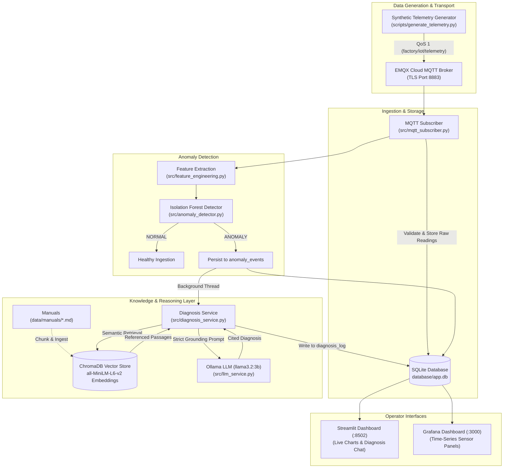

# Knowledge-Driven IoT Fault Diagnosis Assistant

[](https://www.python.org/)
[](https://scikit-learn.org/)
[](https://www.trychroma.com/)
[-purple.svg)](https://ollama.com/)
[-009688.svg)](https://www.emqx.com/)
[](https://streamlit.io/)
[](https://github.com/astral-sh/ruff)

An intelligent industrial IoT monitoring copilot that observes real-time telemetry from a three-phase induction motor, detects anomalies using unsupervised machine learning, and produces plain-English diagnoses strictly grounded in manufacturer equipment manuals—**with exact source citations, not AI hallucinations**.

---

## Table of Contents

- [Problem Statement & Approach](#problem-statement--approach)
- [System Architecture & Pipeline](#system-architecture--pipeline)
- [Repository Structure](#repository-structure)
- [Prerequisites](#prerequisites)
- [Setup & Installation](#setup--installation)
  - [Option A: Local Setup (Standard Python)](#option-a-local-setup-standard-python)
  - [Option B: Docker Compose (All-in-One)](#option-b-docker-compose-all-in-one)
- [Running the Project](#running-the-project)
- [Dashboards Overview](#dashboards-overview)
- [Model Evaluation & Testing](#model-evaluation--testing)
- [Configuration Reference](#configuration-reference)

---

## Problem Statement & Approach

In modern industrial facilities, telemetry threshold alarms are prone to false alarms and alert fatigue. When equipment malfunctions, maintenance technicians must manually sift through dense technical manuals to determine the root cause. General-purpose large language models (LLMs) cannot solve this reliably out-of-the-box due to hallucinated causes, invented operating specs, and lack of accountability.

This project delivers an end-to-end knowledge-driven solution:
1. **Physics-Consistent Telemetry:** Telemetry models a 400V / 15A / 7.5kW industrial induction motor and energy meter. Three-phase power calculations ensure electrical fidelity ($P = \sqrt{3} \cdot V \cdot I \cdot \cos\phi$).
2. **Unsupervised Anomaly Detection:** An Isolation Forest analyzes five core features (`voltage`, `current`, `power_kw`, `power_factor`, `temperature`) without requiring pre-labeled training data.
3. **Retrieval-Augmented Generation (RAG):** When an anomaly occurs, out-of-range sensor symptoms are translated into technical queries against a local ChromaDB vector store indexed with official equipment documentation (`data/manuals/motor_fault_reference.md`).
4. **Grounded & Cited Explanations:** The local Ollama LLM (`llama3.2:3b`) operates under strict prompting constraints: it answers **only** using retrieved manual passages and explicitly cites the source section. Weak similarity matches trigger a `low_confidence` warning.

---

## System Architecture & Pipeline



### Injected Fault Modes
The publisher can inject five realistic industrial fault scenarios:
- **`high_voltage`:** Sustained over-voltage from the supply grid (e.g. 430–450V).
- **`low_voltage`:** Voltage sag causing motor current to spike and power factor to drop.
- **`high_current`:** Excessive current draw (>15A) caused by mechanical overload or bearing drag.
- **`high_temperature`:** Thermal buildup (70–85°C) caused by cooling fan failure or ventilation blockage.
- **`low_power_factor`:** Significant drop in power factor (<0.75) from light loading or winding defects.

---

## Repository Structure

```
iot-fault-assistant/
│
├── config/
│   └── project.yaml            # Operational settings, thresholds & model parameters
├── dashboard/
│   └── app.py                  # Streamlit application: live view, anomaly log & chat
├── data/
│   └── manuals/
│       └── motor_fault_reference.md  # Ground-truth industrial reference manual
├── database/
│   └── app.db                  # SQLite database (telemetry, anomalies, diagnoses)
├── grafana/
│   └── provisioning/           # Auto-provisioned SQLite datasource & dashboard JSON
├── models/
│   └── isolation_forest.joblib # Serialized Isolation Forest model artifact
├── rag_store/                  # ChromaDB vector store directory
├── scripts/
│   ├── generate_telemetry.py   # Telemetry publisher CLI (with fault injection flags)
│   ├── train_model.py          # Trains Isolation Forest on healthy readings
│   ├── ingest_manuals.py       # Chunks and embeds manuals into ChromaDB
│   └── evaluate_model.py       # Computes precision, recall & F1 against injected faults
├── src/
│   ├── anomaly_detector.py     # Isolation Forest train/predict/save/load
│   ├── config.py               # Central configuration loader (YAML + .env)
│   ├── database.py             # SQLite interface with foreign key constraints
│   ├── diagnosis_service.py    # Anomaly -> Query -> RAG -> Prompt -> Citation verification
│   ├── feature_engineering.py  # 5-feature vector extraction
│   ├── llm_service.py          # Ollama REST API client
│   ├── mqtt_publisher.py       # Synthetic motor telemetry generator
│   ├── mqtt_subscriber.py      # MQTT subscriber and pipeline orchestrator
│   ├── prediction_service.py   # High-level NORMAL / ANOMALY prediction wrapper
│   ├── utils.py                # MQTT client helper functions
│   └── rag/
│       ├── ingest.py           # Markdown chunker & SentenceTransformers embedder
│       └── retriever.py        # Semantic cosine similarity search
├── tests/                      # Comprehensive pytest unit & integration test suite
├── .env.example                # Template for environment variables and secrets
├── Dockerfile                  # Self-contained multi-stage Docker build
├── docker-compose.yml          # Compose file for app, subscriber, publisher & Grafana
├── pyproject.toml              # Ruff and pytest project configuration
├── requirements.txt            # Python dependencies
└── README.md                   # Project documentation
```

---

## Prerequisites

1. **Python 3.12+**
2. **EMQX Cloud Broker:** An active EMQX Cloud instance (Free Tier) with TLS enabled.
3. **Ollama:** [Download & install Ollama](https://ollama.com/), then pull the diagnostic model:
   ```bash
   ollama pull llama3.2:3b
   ```
4. **Docker & Docker Compose** *(optional, if running containerized)*

---

## Setup & Installation

### Option A: Local Setup (Standard Python)

#### 1. Clone & Set Up Virtual Environment

```bash
git clone https://github.com/<your-username>/iot-fault-assistant.git
cd iot-fault-assistant

# Create virtual environment
python -m venv .venv

# Activate virtual environment
# Windows (PowerShell):
.venv\Scripts\Activate.ps1
# Linux/macOS:
source .venv/bin/activate

# Install dependencies
pip install -r requirements.txt
```

#### 2. Configure Environment Variables

Copy the `.env.example` file to `.env`:

```bash
cp .env.example .env
```

Open `.env` and verify your EMQX Cloud broker settings:

```dotenv
# --- EMQX Cloud (MQTT) ---
MQTT_BROKER_HOST=your-broker.emqxsl.com
MQTT_BROKER_PORT=8883
MQTT_USERNAME=your-username
MQTT_PASSWORD=your-password
MQTT_USE_TLS=true

# --- LLM backend ---
LLM_BACKEND=ollama
OLLAMA_MODEL=llama3.2:3b
OLLAMA_HOST=http://localhost:11434

# --- Misc ---
LOG_LEVEL=INFO
```

#### 3. Build Model & Vector Store

Generate the Isolation Forest model and build the ChromaDB vector database:

```bash
# 1. Train the anomaly detector on simulated healthy readings
python scripts/train_model.py

# 2. Ingest documentation into ChromaDB
python scripts/ingest_manuals.py --query "motor running hot"
```

---

### Option B: Docker Compose (All-in-One)

With Docker and Ollama running on your host machine:

```bash
# 1. Ensure .env is populated with your EMQX credentials
cp .env.example .env

# 2. Pull the Ollama model on the host
ollama pull llama3.2:3b

# 3. Start the entire container stack
docker compose up --build
```

This starts:
- `subscriber`: Receives readings, scores anomalies, and triggers diagnoses.
- `publisher`: Publishes telemetry and injects a test high-temperature fault after ~100s.
- `app`: Streamlit dashboard at [http://localhost:8502](http://localhost:8502).
- `grafana`: Grafana dashboard at [http://localhost:3000](http://localhost:3000).

---

## Running the Project

If running locally (without Docker), open **three terminal windows** with your virtual environment activated:

### Terminal 1: Ingestion & Anomaly Scoring Service
Start the MQTT subscriber that listens for sensor data, saves to SQLite, detects anomalies, and executes RAG diagnoses:

```bash
python -m src.mqtt_subscriber
```

### Terminal 2: Telemetry Publisher (Motor Simulator)
Start simulated telemetry publishing with a test fault:

```bash
# Normal operation for 20 readings, then 10 high-temperature fault readings
python scripts/generate_telemetry.py --fault=high_temperature --fault-after=20 --fault-count=10
```

Available `--fault` options:
`high_voltage`, `low_voltage`, `high_current`, `high_temperature`, `low_power_factor`

### Terminal 3: Streamlit Operator Dashboard
Launch the interactive technician dashboard:

```bash
streamlit run dashboard/app.py
```
Open [http://localhost:8502](http://localhost:8502) in your browser.

---

## Dashboards Overview

### 1. Streamlit Operator Dashboard (`:8502`)
- **Live KPI Metrics:** Real-time Voltage, Current, Active Power, Power Factor, and Temperature with delta indicators.
- **Time-Series Charts:** Interactive Plotly graphs plotting the latest 100+ sensor readings. Flagged anomalies are visually marked with **red dots**.
- **Anomaly Events Log:** Chronological table displaying flagged anomalies, scores, and diagnostic status.
- **Interactive Diagnosis Chat:** Select any anomaly to view the LLM explanation, confidence rating (`grounded` or `low_confidence`), and expand the exact cited sections from the technical manuals.

### 2. Grafana Visualization (`:3000`)
- Auto-configured to connect to `database/app.db` via the SQLite plugin.
- Continuous, auto-refreshing industrial panels tracking sensor trends over time.
- Default credentials: `admin` / `admin`.

---

## Model Evaluation & Testing

### Evaluation Against Injected Faults
To evaluate the detector's accuracy on held-out test data across all five fault scenarios:

```bash
python scripts/evaluate_model.py --healthy 2000 --per-fault 100
```

Typical evaluation output:
```text
Eval set (seed=2024): 2500 readings = 2000 healthy + 500 faulty (100 x 5 scenarios)

Confusion matrix (positive class = ANOMALY)
  TP=450    FP=60    
  FN=50     TN=1940  

Precision: 0.882
Recall:    0.900
F1:        0.891
False-positive rate on healthy: 0.030

Recall per fault scenario
  high_voltage       0.950
  low_voltage        1.000
  high_current       1.000
  high_temperature   0.550
  low_power_factor   1.000
```

### Running Automated Unit Tests & Linter
The repository includes a comprehensive test suite covering the database schema, feature engineering, Isolation Forest, retrieval mechanisms, and mocked LLM responses:

```bash
# Run linter
ruff check .

# Run unit tests
pytest -v
```

---

## Configuration Reference

### `config/project.yaml`
- `project.device_id`: Device identifier (e.g. `MOTOR-001`).
- `project.telemetry_interval_seconds`: Publish frequency (default: 5s).
- `ml.contamination`: Isolation Forest expected contamination factor (default: `0.05`).
- `rag.chunk_size`: Maximum character size for text chunks (default: `400`).
- `rag.chunk_overlap`: Character overlap between adjacent chunks (default: `50`).
- `rag.low_confidence_threshold`: Minimum cosine similarity score required for high-confidence grounding (default: `0.35`).
- `dashboard.refresh_seconds`: Streamlit live view refresh rate (default: `10`).

---

## License

This project is built for educational and demonstration purposes.
